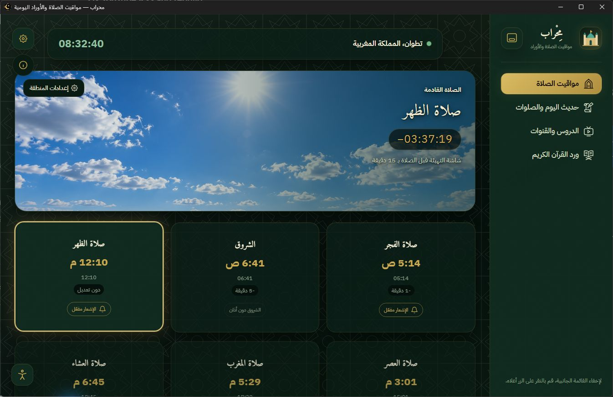
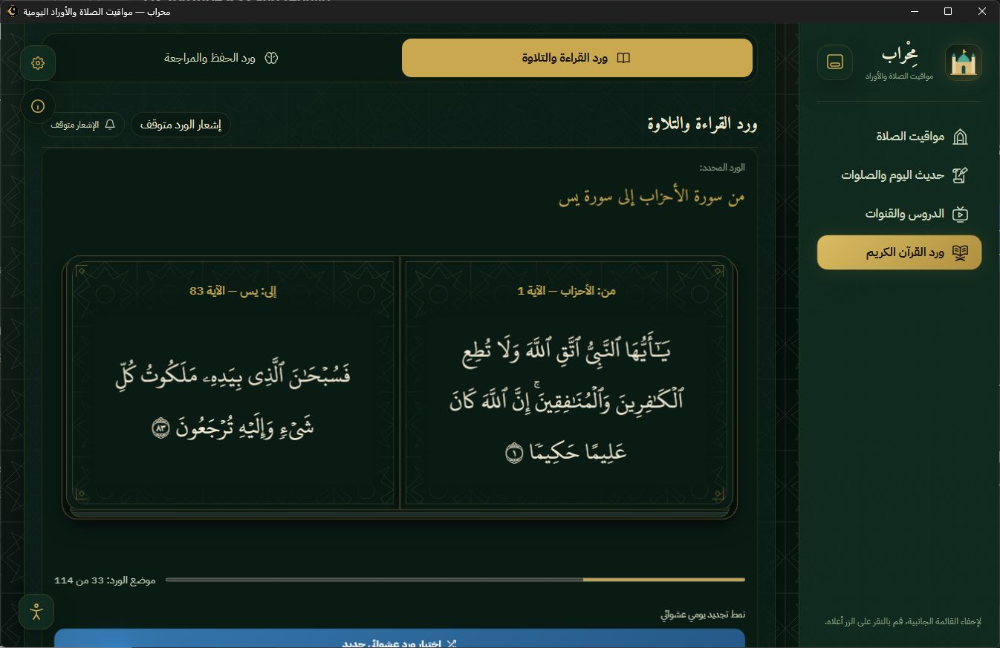
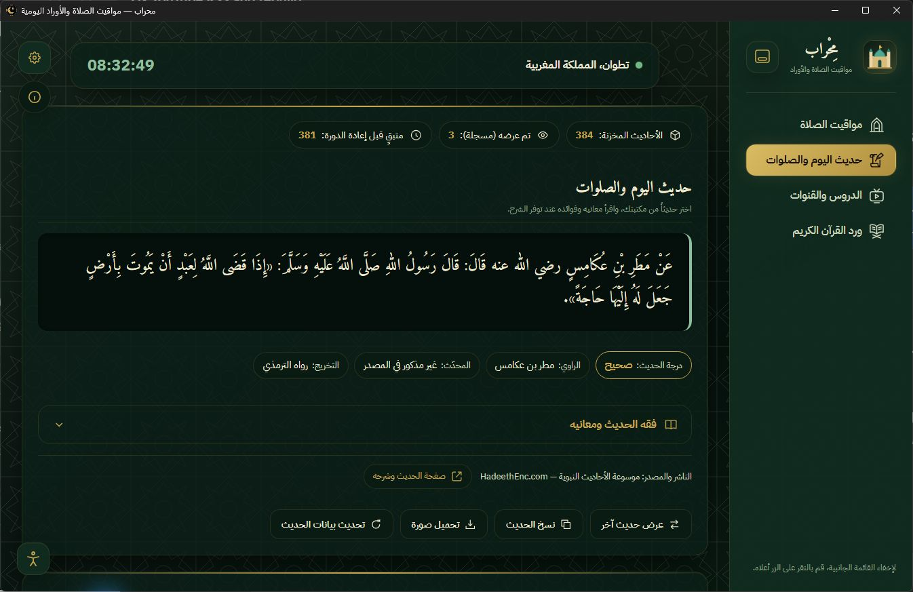

بسم الله الرحمن الرحيم

<p align="center"></p>

# محراب — وقف عن جدّي رحمه الله

هذا المشروع، بنسختيه للهاتف والحاسوب، وقف عن جدّي رحمه الله، رجاء أن يصله ثواب هذا العمل وأن ينفع الله به. خُصّص محراب لهذا الغرض إثر وفاته.

يساعد محراب على تقليل التشتيت والمحافظة على الفروض والسنن اليومية، وبناء نظام يومي نافع من الصلاة والقرآن والذكر والتعلّم. التطبيق أداة؛ والمنفعة تتحقق بإحسان استخدام الأدوات المتاحة


# محراب

محراب لتنظيم الصلاة وقراءة أوراد القرآن بحفص وورش ومتابعة الأذكار والأحاديث والدروس، مع شاشة التهيئة للصلاة وقوالب عصرية وتقليدية.

صنعت هذا المشروع ليكون نافعاً ومتاحاً دون اشتراك أو إعلانات. يعمل محلياً، ولا يحتاج إلى حساب خاص بمحراب. وتبقى المواقيت المحسوبة والمواد المرفقة والتقدم في الأوراد متاحة دون إنترنت.

## تحميل التطبيق

التطبيق متاح حالياً لويندوز 64 بت:

- [تحميل ملف التثبيت](https://github.com/Mohamed2006-Dev/mihrab-app/releases/latest/download/Mihrab-Setup.exe)
- [تحميل النسخة المحمولة 1.0.1](https://github.com/Mohamed2006-Dev/mihrab-app/releases/download/v1.0.1/Mihrab-Portable.exe)
- [كل الإصدارات وملاحظات التحديث](https://github.com/Mohamed2006-Dev/mihrab-app/releases)

اختر ملف التثبيت إن أردت تثبيت محراب والحصول على التحديثات من داخل التطبيق. النسخة المحمولة تعمل دون تثبيت، لكن التحديث الداخلي غير متاح فيها. الملفات يستضيفها GitHub مباشرة، ويمكنك الرجوع إلى صفحة الإصدارات لتحميل إصدار أقدم دون حذف الإصدارات الأخرى.

## رسالة Windows SmartScreen

قد يعرض ويندوز رسالة «Windows protected your PC» أو أن التطبيق غير معروف. هذا التحذير يتعلق بسمعة التطبيق والتوقيع الرقمي؛ النسخة الحالية غير موقعة بشهادة رقمية. ظهور رسالة التطبيق غير المعروف ليس بحد ذاته اكتشافاً لفيروس. [توضيح Microsoft لسمعة التطبيقات في SmartScreen](https://learn.microsoft.com/windows/apps/package-and-deploy/smartscreen-reputation).

## ماذا يقدم محراب؟

- مواقيت الصلاة بحسب المدينة وطريقة الحساب، مع حساب محلي وإمكانية المطابقة عبر الإنترنت.
- الأذان والتنبيهات، مع تخصيص كل صلاة والجمعة وأوقات التذكير.
- شاشة للتهيئة قبل الصلاة تساعدك على ترك الحاسوب، وتختفي عند موعد الأذان.
- ورد قراءة مستقل عن ورد الحفظ والمراجعة، مع حفظ التقدم ودعم روايتي حفص وورش.
- أحاديث وشروح من موسوعة الأحاديث النبوية HadeethEnc، مع معلومات المصدر وإمكانية حفظ الحديث كصورة.
- اقتراح مقاطع من قنوات يوتيوب التي تختارها، وفتح المقطع مباشرة على يوتيوب.
- خيارات للمظهر وتكبير النصوص وتقليل الحركة، وثلاثة مستويات للأداء.
- أدوات للاطلاع على التخزين والاستهلاك والتحكم باتصال كل خدمة بالإنترنت.

بعد التشغيل، راجع المدينة والمنطقة الزمنية وطريقة الحساب. المواقيت قد تختلف بحسب الجهة المحلية، ولذلك تظل مراجعتها مهمة، خاصة للصيام. وقد يختلف عرض الرسم القرآني على بعض الشاشات؛ يسعدني تلقي بلاغ واضح إن وجدت خطأ.

## جولة بالصور

### مواقيت الصلاة



### ورد القرآن الكريم



### الأحاديث وشروحها



## البيانات والخصوصية

يحفظ محراب إعداداتك وتقدمك والمواد المخزنة على جهازك. لا نستخدم حسابات سحابية لمزامنتها، ولا نضيف أدوات تتبع أو إعلانات.

عند السماح بالإنترنت، يتصل التطبيق بمصادر الأحاديث والمواقيت وخلاصات يوتيوب وصورها وخدمة كشف الموقع، وبـGitHub للتحقق من التحديثات. لهذه الخدمات سياساتها الخاصة، وقد تتلقى بيانات الاتصال مثل عنوان IP. يمكنك التحكم في الاتصالات من الإعدادات. عند منع الشبكة يستمر العمل المحلي، بينما تتوقف الخدمات التي تحتاج إلى جلب بيانات جديدة.

التبليغ عن الأخطاء اختياري: تراجع المسودة أولاً، ثم تكمل إرسالها بنفسك عبر المنصة التي تختارها. لا يرسل التطبيق سجلات جهازك تلقائياً.

## تشغيل المشروع من المصدر

تحتاج إلى Node.js وnpm. من مجلد المشروع:

```sh
npm ci
npm start
```

الكود الرئيسي في `main.js`، وجسر الواجهة في `preload.js`، والمحركات في `src/engines/`، والواجهة في `src/ui/`، والقوالب في `themes/`.

المستودع يحتوي الملفات اللازمة للتطبيق وبياناته المرجعية، ويستبعد إعدادات المطور الشخصية والكاش ومخرجات البناء والتجارب المحلية. بعض بيانات التواصل في النسخ المنشورة تُجهّز محلياً؛ عدم وجودها في نسخة مطور جديدة لا يمنع تشغيل الخدمات الأساسية.

## الاستخدام والحقوق

يمكنك قراءة الكود ودراسته وتعديله وإعادة توزيعه للاستخدام غير التجاري، وفق [شروط المشروع](LICENSE)، مع احترام الضوابط الشرعية وحقوق المصادر الخارجية. لا يلزم ذكر اسم المطور للكود الأصلي، لكن تبقى إشعارات وتراخيص المكتبات والخطوط والمحتوى الخارجي واجبة الاحترام. هذه شروط إتاحة مخصصة وليست رخصة مصدر مفتوح معتمدة تسمح بالاستخدام التجاري.

الدعم الطوعي مسموح إذا أُنفق فيما يرضي الله عز وجل، ولا يشتري صاحبه ميزة أو محتوى؛ يبقى التطبيق متاحاً للجميع دون دفع. تجد وسائل دعم تطوير المشروع داخل نافذة «عن التطبيق».

الأحاديث وشروحها من [HadeethEnc](https://hadeethenc.com/ar)، وتوثيق موارد القرآن موجود في [ملف المصادر](data/quran-sources.md). تبقى المقاطع لأصحابها على يوتيوب، ولا يرفع محراب ملفاتها أو يملك محتواها.

إن انتفعت بالمشروع، فأسأل الله أن يبارك لك فيه. وإن وجدت خللاً، فبلاغك أو مساهمتك في إصلاحه يساعدان على تحسينه.

## نسخة الهاتف

يمكنك الاطلاع على [مستودع محراب لهواتف Android](https://github.com/Mohamed2006-Dev/mihrab-phone) وتحميل APK من [صفحة إصدارات الهاتف](https://github.com/Mohamed2006-Dev/mihrab-phone/releases).
